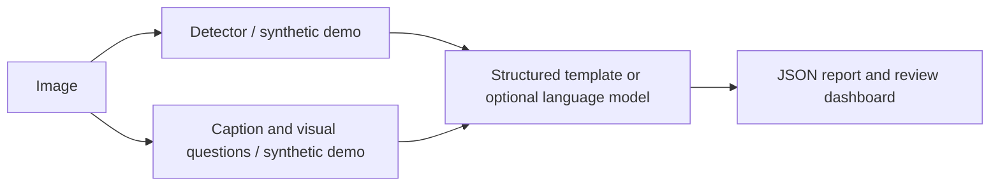

# Argus

**A vision-language inspection workflow for exploring defect localization, image description, visual questions, and structured reporting.**

Argus connects a detector, a vision-language model, and a report generator behind a FastAPI service and Streamlit dashboard. It is an applied multimodal AI prototype with an explicit offline demonstration mode—not a validated industrial inspection product.

## Quick start

Python 3.12+ recommended. Dependency installation requires internet; default demo execution does not download model weights or need an API key.

```sh
python3 -m venv .venv
source .venv/bin/activate
pip install -r requirements-dev.txt
export ARGUS_MODE=demo
python -m streamlit run app/streamlit_app.py --server.address 127.0.0.1
```

Open http://localhost:8501. Load a sample image or upload an image and run the inspection workflow. **Demo boxes, captions, and answers are synthetic placeholders, not findings derived from image content.** They illustrate orchestration and interface behavior only. Template reports built from these placeholders are also synthetic.

Run the API separately:

```sh
python -m uvicorn api.main:app --host 127.0.0.1 --port 8000
```

API reference: http://localhost:8000/docs. The dashboard runs the pipeline in its own process; it does not require the API server. Both are alternative interfaces to the same modules.

## Verification

```sh
pytest -q
ruff check src api app experiments data tests
ruff format --check src api app experiments data tests
```

Tests cover detector/VLM demo behavior, template reports, orchestration, bounding-box metrics, duplicate predictions, cross-image matching, invalid uploads, unsafe IDs, and malformed question lists.

Detection evaluation uses **11-point interpolated AP at one IoU threshold**, averaged over classes present in the ground truth; it is not COCO mAP@[0.5:0.95]. Predictions are matched one-to-one to ground truth; when pooling images, include matching `image_id` fields on both predictions and labels. Predictions for unlabeled classes affect overall precision but do not create extra AP classes. BLEU/ROUGE measure text overlap and do not establish correctness, diagnostic quality, or safe recommended actions. Synthetic demo outputs must not be presented as a model benchmark.
The evaluation endpoint requires an aligned reference for each supplied caption
and report. It rejects mismatched lists; missing metric dependencies raise an
error instead of emitting placeholder scores. Detection records inherit their
parent `image_id` when individual boxes do not specify one. Detection evaluation
rejects nonfinite or zero-area boxes, out-of-range confidence scores, and invalid
IoU thresholds before calculating AP.

For a research extension, evaluate a held-out real dataset with defect-trained weights, compare detector and VLM variants, report per-class precision/recall and localization metrics, measure latency/memory on named hardware, and conduct human review of report faithfulness. These are future experiments, not shipped results.

## Architecture



| Component | Implementation |
|---|---|
| Detection | Optional Ultralytics YOLO checkpoint; deterministic demo placeholders |
| Vision-language | Optional BLIP-2 or LLaVA adapters |
| Reporting | Template baseline; optional Transformers text-generation adapter |
| API | FastAPI and Pydantic |
| Dashboard | Streamlit, Plotly, OpenCV annotations |
| Evaluation | IoU, single-threshold 11-point AP, BLEU, ROUGE |
| Experiment tooling | Training/benchmark scripts; optional MLflow integration |

## Demo versus model inference

`ARGUS_MODE=demo` is the default. Heavy model imports and downloads are skipped, and inspection API metadata contains `synthetic: true`. This is a workflow demonstration, not computer-vision inference.

For model inference, install the additional dependencies in a compatible environment:

```sh
pip install -r requirements-models.txt
export ARGUS_MODE=model
```

Configure `config.yaml` with a **local defect-trained YOLO checkpoint** and your VLM/report model choices, then restart. Generic COCO weights are not a trained industrial defect detector. Real detector/VLM loading failures raise errors rather than silently inventing inspection findings. The dashboard has its own model selectors; select the intended local checkpoint there too.

BLIP-2/LLaVA and optional language models can require substantial RAM/VRAM, network downloads, and model-specific access approval. CUDA quantization may require a separately installed, platform-compatible bitsandbytes package. Live model inference, hardware compatibility, and trained-checkpoint accuracy have not been verified by the demo test suite.

## Inspection and reporting

The pipeline produces detections, caption text, visual question answers, a structured report, timestamps, and model metadata. Reports contain review-oriented summaries and suggested actions, not certified decisions. Confidence scores are model scores, not calibrated probabilities of safety. Severity is heuristic and has not been calibrated against material properties, physical dimensions, or operational risk.

No trained defect checkpoint or real labeled industrial evaluation dataset is supplied. Generated sample images and their labels are synthetic demonstration fixtures. They do not support accuracy claims about real manufacturing defects.

## API

| Endpoint | Purpose |
|---|---|
| `GET /health` | Service status and explicit demo/model mode |
| `POST /detect` | Detection results |
| `POST /caption` | Image description |
| `POST /vqa` | Visual question answering |
| `POST /inspect` | Full inspection workflow |
| `POST /visualize` | Annotated PNG |
| `POST /evaluate` | Detection/text metrics |
| `GET /experiments` | Recent persisted inspection results |
| `GET /experiments/{image_id}` | One saved inspection |

Image uploads are bounded to 10 MB and 20 megapixels. Image IDs permit letters, digits, underscores, and hyphens. Custom inspection questions must be a JSON list of at most ten nonempty strings, each up to 500 characters.

Saved API inspections go to `outputs/inspections/` by default; override with `ARGUS_RESULTS_DIR`. Back up this directory when needed. These JSON reports can contain sensitive inspection details. Source images are decoded in memory by the API.

## Containers

```sh
docker compose up --build
```

API: http://localhost:8000; dashboard: http://localhost:8501. Compose defaults to demo mode and binds host ports to loopback. A named volume preserves API reports. Docker packaging is supplied but has not been verified locally.

## Repository map

- `src/detection/`: detector and visualization
- `src/vlm/`: caption and visual-question adapters
- `src/llm/`: report templates and optional generation
- `src/pipeline.py`: orchestration and persistence
- `src/evaluation/`: detection/text metrics
- `api/`: HTTP interface
- `app/`: review dashboard
- `data/`: synthetic sample generator and labels
- `experiments/`: training, tracking, and benchmark tools

## Scope and responsible use

Local single-workspace prototype: no authentication, tenant isolation, certified calibration, or deployment hardening. Add access control and HTTPS before network exposure. Review image content, detections, descriptions, and recommendations manually. Do not use demo results or unvalidated model output for maintenance, safety, or production acceptance decisions.

## License

[MIT License](LICENSE) for the project code. Third-party software, models, and datasets retain their own terms.
